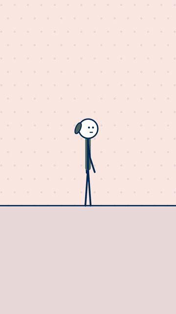
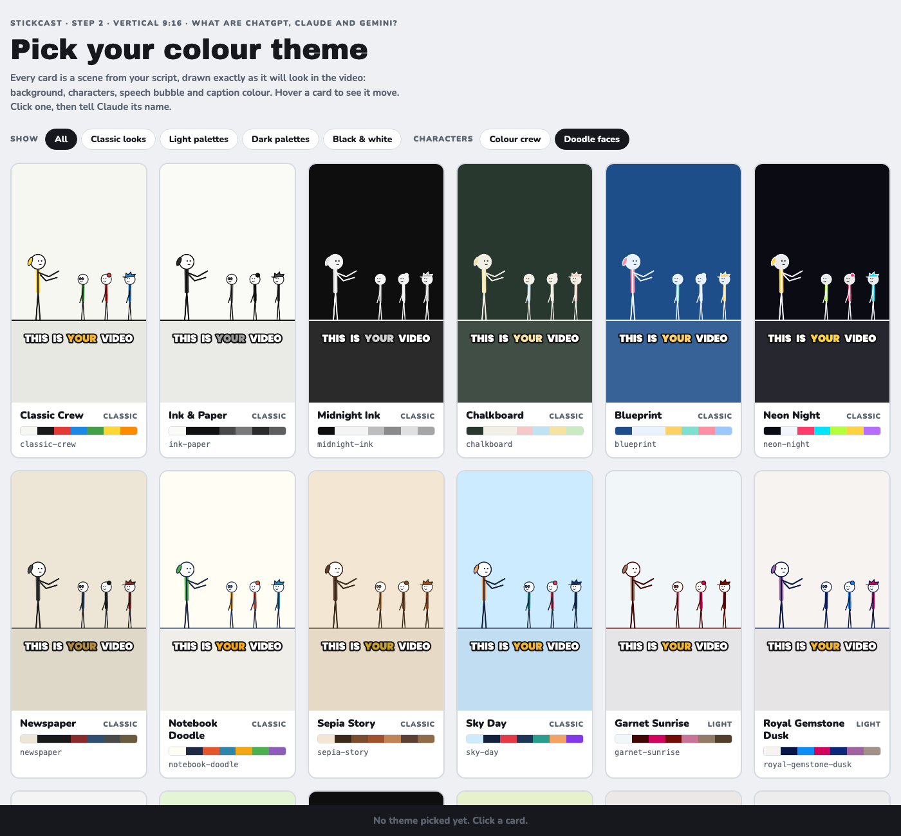

# stickcast

**Faceless stick-figure videos, narrated.** A skill for Claude Code by **Ritu Dadhwal**.

Type a topic. Get a finished stick-figure video with voiceover, captions and a thumbnail, ready for YouTube, Shorts, Reels or TikTok. No camera, no face, no animation software.



*A 35-second Short made with stickcast: "What are ChatGPT, Claude and Gemini?" Script, theme, voice, captions, render and thumbnail are all in [`examples/ai-assistants`](examples/ai-assistants).*

---

## Why stick-figure videos?

Faceless stick-figure channels are one of the biggest quiet successes on YouTube. Simple coloured stick characters explain money, science and history, act out school and dating jokes, and fight in choreographed battles. Compilations and episodes in this style regularly pass **5 to 20+ million views**.

People make real money with them:

- **Explainer channels** turn a script and simple visuals into evergreen videos that earn ad revenue for years.
- **Shorts and Reels creators** post a funny 30-second stick scene every day and grow fast.
- **Freelancers** sell custom explainer videos to brands, schools and startups.

None of them show their face. The hard part has always been the animation. **stickcast does the animation for you.**

> Earnings depend on your niche, your consistency and YouTube's rules. Read [GUIDE.md](GUIDE.md) for an honest path from first video to monetization.

## What makes it different

- **Your colours, your look.** 58 colour themes: classic black & white, chalkboard, blueprint, neon, newspaper, plus 48 palettes from Figma's colour palette collection. Or paste your own brand colours. You pick from a **visual page where every theme shows your own scene**, not a row of colour dots.
- **Two character styles.** *Colour crew* (bold solid-colour figures) or *Doodle faces* (ink lines and round white heads with expressions).
- **A real voice and real timing.** Free voices built into your Mac, your own recording, or AI voices. Every scene lasts exactly as long as its sentence, and actions land on the word that triggers them.
- **Captions that pop.** Four caption styles, timed word by word.
- **You approve every step.** Nothing gets built on a guess, so nothing gets redone.
- **Thumbnail included.** Big outlined text in your theme, with your characters.
- **16:9 and 9:16.** Long-form YouTube and vertical Shorts from the same story.

## How it works

You talk to Claude. stickcast walks you through nine steps and waits for your OK at each one.

| Step | What you see | You |
|---|---|---|
| 1. Script | The script in chat, one line per scene | approve or edit |
| 2. Colour theme | A page of 58 themes, each drawing your scene | pick one |
| 3. Storyboard *(optional)* | A page with one card per scene | approve, or skip this step |
| 4. Voice | 3 voice samples to listen to | pick one |
| 5. Captions | A page playing 4 caption styles over your scene | pick one |
| 6. Animate | Claude stages every scene to the voice | - |
| 7. Captions | Timed word by word to the voice | - |
| 8. Render | An MP4 rendered with HyperFrames, plus a live preview you can tweak | watch |
| 9. Thumbnail | A 1280×720 thumbnail | approve |



## Install

```bash
npx skills add ritu-dadhwal4/stickcast
```

Or copy this folder into `~/.claude/skills/stickcast`.

**You also need:** Node 18+, [ffmpeg](https://ffmpeg.org), Google Chrome, and [HyperFrames](https://hyperframes.heygen.com) (it runs through `npx`, nothing to install). The free voices come with macOS; on other systems, bring any voice file per line.

## Make a video

```text
/stickcast why saving $5 a day makes you rich
/stickcast a 60 second Short: POV your mom finds your report card
/stickcast explain how vaccines work, for kids, 3 minutes
/stickcast red vs blue stick fight, 30 seconds, no narration
/stickcast 5 money mistakes people make in their 20s, vertical
```

Then just answer the questions: approve the script, pick a theme, pick a voice, pick captions, and approve the thumbnail.

**Ask for changes in plain words:**
"give Riya a chef hat", "slower voice", "put the chart before the coins", "use the chalkboard theme instead", "make it vertical", "add a POW when he gets hit".

## Themes

| Classic looks | |
|---|---|
| Classic Crew | red, blue, green, yellow and orange figures on white |
| Ink & Paper / Midnight Ink | pure black and white, either way round |
| Chalkboard | chalk colours on a green board |
| Blueprint | engineer blue with a grid |
| Neon Night | glowing colours on near black |
| Newspaper, Sepia Story | retro print and old-photo browns |
| Notebook Doodle | pen on lined paper |
| Sky Day | a bright outdoor sky |

Plus 48 palette themes from Figma's colour palette collection, such as Emerald Tangerine Morning, Sapphire Coral Breeze and Aqua Ruby Nightfall. stickcast maps each palette to background, lines and character colours automatically, and keeps the contrast readable. Add `:dark` to flip any theme to a dark background, or use your own:

```text
theme: #0E0E0E,#F36363,#41D2EF,#FCB404:dark
```

## What's inside

```
SKILL.md                 the step-by-step flow Claude follows
runtime/stick.js         the animation engine (figures, 37 poses, 13 expressions, 46 props)
themes/themes.json       58 colour themes
scripts/                 project setup, theme picker, storyboard, voice, captions, build, thumbnail
docs/story-format.md     how a video is described, scene by scene
examples/                finished videos with their story files
GUIDE.md                 how to make money with faceless stick videos
```

Every frame is drawn from one small engine as a pure function of time, so the preview pages, the thumbnail and the final render always match.

## Play fair

Make your own characters and stories. Don't recreate characters, logos or worlds from other creators or games, and don't re-voice other people's animations. YouTube demonetizes that, and it isn't yours to sell. The [guide](GUIDE.md) explains how to stay monetizable.

## Credits

Built by **Ritu Dadhwal**. Inspired by the idea of [stick-scene](https://github.com/nilbuild/stick-scene) by Kamran Ahmed, which draws stick-figure widgets for websites; stickcast is a separate, from-scratch engine made for narrated video. Palette colours are from [Figma's colour palette collection](https://www.figma.com/color-palettes/). Video rendering by [HyperFrames](https://hyperframes.heygen.com).

## License

MIT © 2026 Ritu Dadhwal
